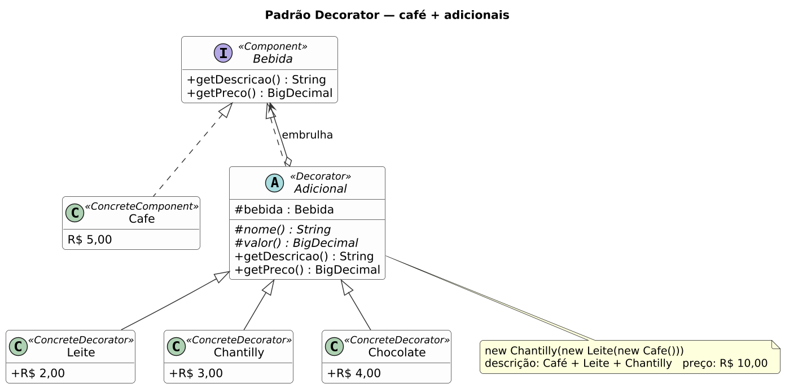

# ☕ Cafeteria — Padrões de Projeto em Java

Trabalho de **Arquitetura de Software e Padrões de Projetos — 2º bimestre 2026**.

## 📚 Sobre o projeto
Programa de terminal onde o cliente **monta um café com adicionais**. Ao finalizar, o pedido é numerado e o **barista** e o **caixa** são avisados.
Sem banco de dados: tudo roda em memória.

## 🎯 Padrões de projeto aplicados (3 de 10)

| Padrão | Categoria | Onde está | O que resolve |
|---|---|---|---|
| **Singleton** | Criacional | `singleton/GerenciadorPedidos` | Um único gerenciador: o número do pedido nunca se repete |
| **Decorator** | Estrutural | `decorator/*` | Café + adicionais empilhados, sem uma classe para cada combinação |
| **Observer** | Comportamental | `observer/*` | Barista e caixa são avisados do pedido sem acoplamento |

Propósito, motivação e como explicar cada um: [`doc/txt/PADROES.md`](doc/txt/PADROES.md).

## 📐 UML

| Singleton | Decorator | Observer |
|---|---|---|
|  |  |  |

## ▶️ Exemplo de execução
```
Seu pedido: Café + Leite + Chantilly = R$ 10,00

[Barista] Preparar o pedido #1: Café + Leite + Chantilly
[Caixa]   Registrar R$ 10,00 (pedido #1)
```
A opção **3 - Demonstração dos 3 padrões** do menu mostra os três funcionando sem digitar nada.

## 📂 Organização
```
cafeteria/
├── README.md
├── doc/
│   ├── txt/   PADROES.md
│   └── uml/   01-singleton, 02-decorator, 03-observer (.puml e .png)
├── scripts/   compilar e executar (.sh e .bat)
└── src/
    ├── Main.java            menu do terminal
    ├── model/               Pedido
    ├── decorator/           Bebida, Cafe, Adicional, Leite, Chantilly, Chocolate
    ├── observer/            PedidoObserver, Barista, Caixa
    └── singleton/           GerenciadorPedidos
```

## 🚀 Como executar
Requisito: **Java 17+** (confira com `javac -version`). Na pasta do projeto:
- Windows: `scripts\compilar.bat` e depois `scripts\executar.bat`
- Linux/Mac: `scripts/compilar.sh` e depois `scripts/executar.sh`

No VS Code: abra a pasta `cafeteria` e execute `src/Main.java`.

## 🛠️ Tecnologias
Java 17+ · PlantUML · Visual Studio Code · Git e GitHub

---
Disciplina: Arquitetura de Software e Padrões de Projetos · Linguagem: Java
