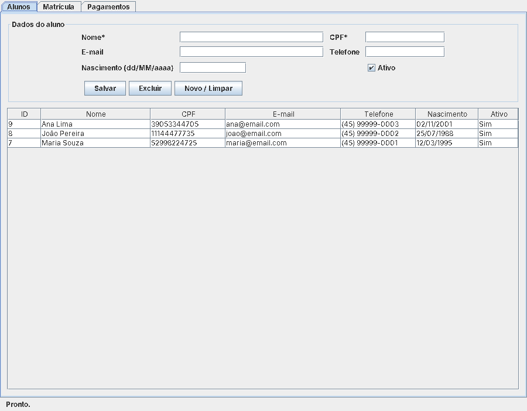
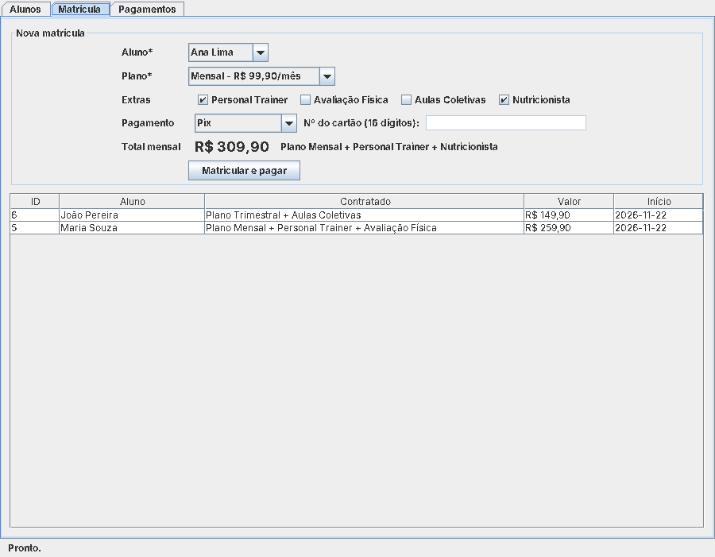
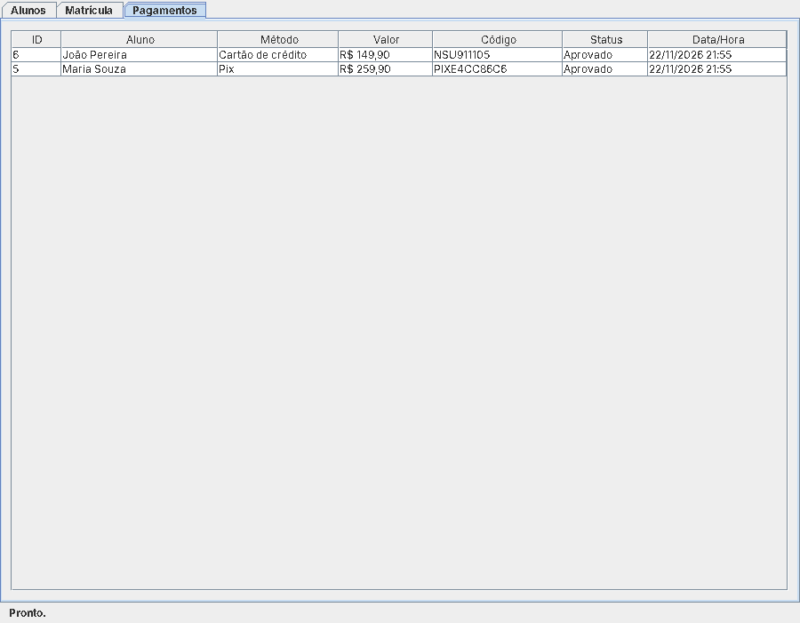

# 🏋️ Academia — Padrões de Projeto em Java (Swing + MySQL)

Trabalho de **Arquitetura de Software e Padrões de Projetos — 2º bimestre 2026**.

## 📚 Sobre o projeto

Sistema de gestão de academia: cadastro de **alunos**, **matrícula em planos** (com serviços extras) e **pagamento** (Pix ou cartão).
Foi construído para **aplicar padrões de projeto em um software real**, seguindo a organização de pastas do projeto UNIVEL
(`model`, `dao`, `controller`, `util`, `view`).

## 🎯 Padrões de projeto aplicados (3 de 10, um de cada categoria)

| Padrão | Categoria | Onde está | Problema que resolve |
|---|---|---|---|
| **Singleton** | Criacional | `src/dao/ConnectionFactory` | Uma única fábrica/conexão em vez de abrir uma por operação; credenciais fora do código |
| **Decorator** | Estrutural | `src/pattern/decorator/*` | Plano + extras (personal, nutricionista...) sem criar uma subclasse para cada combinação |
| **Observer** | Comportamental | `src/pattern/observer/*` | Telas e log são avisados da matrícula sem acoplar ao controller |

Para cada padrão: propósito, motivação, estrutura e como explicar em [`doc/txt/PADROES.md`](doc/txt/PADROES.md).

## 🖼️ Telas

| Alunos | Matrícula (preço calculado pelo Decorator) | Pagamentos (atualiza pelo Observer) |
|---|---|---|
|  |  |  |

## 📐 UML

| Diagrama | Arquivo |
|---|---|
| Pacotes (camadas) | [`doc/uml/01-camadas.png`](doc/uml/01-camadas.png) |
| Classes (visão geral) | [`doc/uml/02-classes.png`](doc/uml/02-classes.png) |
| Singleton | [`doc/uml/03-singleton.png`](doc/uml/03-singleton.png) |
| Decorator | [`doc/uml/04-decorator.png`](doc/uml/04-decorator.png) |
| Observer | [`doc/uml/05-observer.png`](doc/uml/05-observer.png) |
| Sequência: matricular e pagar | [`doc/uml/06-sequencia-matricular.png`](doc/uml/06-sequencia-matricular.png) |
| Modelo de dados (ER) | [`doc/uml/07-banco-er.png`](doc/uml/07-banco-er.png) |


Os diagramas estão também em PlantUML (`.puml`) na mesma pasta. Índice: [`doc/uml/ARQUITETURA.md`](doc/uml/ARQUITETURA.md) e [`doc/uml/UML.md`](doc/uml/UML.md).

## 🧱 Arquitetura em camadas

```
view  ->  controller  ->  dao (interface)  ->  DAOJdbc  ->  MySQL
                  \->  pattern (decorator / observer)
model e util são usados por todas as camadas
```
- A `view` só conhece os controllers.
- SQL só existe nas classes `*DAOJdbc`.
- Regras de negócio ficam nos controllers.
- Credenciais ficam em `resources/db.properties` (fora do git).

## 📂 Organização

```
academia/
├── README.md
├── doc/
│   ├── txt/   sistemaAcademia.txt, PADROES.md
│   └── uml/   diagramas .puml e .png, ARQUITETURA.md, UML.md
├── lib/       conn.jar (driver JDBC do MySQL)
├── resources/ image/ (telas), logs/, db.properties.example
├── scripts/   compilar, executar, demo (.sh e .bat) e git-historico.sh
└── src/
    ├── Main.java · PadroesDemo.java · IntegracaoTeste.java
    ├── model/        Aluno, Plano, Matricula, Pagamento, MetodoPagamento
    ├── dao/          ConnectionFactory, interfaces *DAO, *DAOJdbc, dbAcademia.sql
    ├── controller/   AlunoController, MatriculaController, PagamentoController
    ├── util/         NegocioException, PersistenciaException, Moeda, ResultadoPagamento
    ├── view/         MainFrame, AlunoPanel, MatriculaPanel, PagamentoPanel
    └── pattern/      decorator/, observer/
```

## 🚀 Como executar

Requisitos: **Java 17+** e **MySQL 8** (ou MariaDB) rodando localmente.

1. Crie o banco executando `src/dao/dbAcademia.sql` (MySQL Workbench ou `mysql -u root -p < src/dao/dbAcademia.sql`).
2. Copie `resources/db.properties.example` para `resources/db.properties` e informe usuário e senha do MySQL.
3. Compile e execute:
   - Windows: `scripts\compilar.bat` e `scripts\executar.bat`
   - Linux/Mac: `scripts/compilar.sh` e `scripts/executar.sh`
4. Demonstração dos 3 padrões **sem banco**: `scripts\demo.bat` (ou `scripts/demo.sh`).

No VS Code: abra a pasta raiz `academia`, confirme `lib/conn.jar` em *Referenced Libraries* e execute `src/Main.java`.

## 📋 Regras de negócio

- Nome obrigatório; CPF com 11 dígitos e único; e-mail válido (se informado); nascimento não futuro.
- Só aluno **ativo** pode se matricular.
- O pagamento é processado **antes** de gravar: se for recusado, nada é salvo.
- Matrícula e pagamento são gravados na **mesma transação**.
- Pagamento simulado: Pix sempre aprovado; cartão exige 16 dígitos e número terminado em `0000` simula saldo insuficiente.

## 🛠️ Tecnologias utilizadas

Java 17+ · Swing · JDBC · MySQL · PlantUML · Visual Studio Code · Git e GitHub

## 🌿 Git

Estrutura e convenções em [`doc/uml/ARQUITETURA.md`](doc/uml/ARQUITETURA.md).
Para criar o repositório já com o histórico organizado em commits: `sh scripts/git-historico.sh`.

---
Disciplina: Arquitetura de Software e Padrões de Projetos · Linguagem: Java · Finalidade: trabalho acadêmico (aplicação de padrões de projeto)
