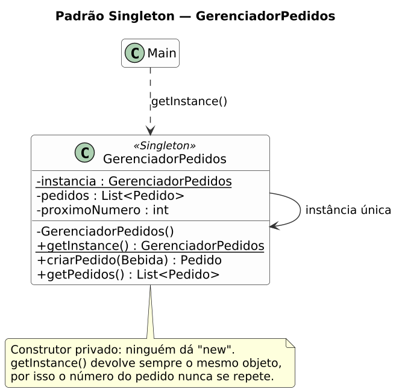
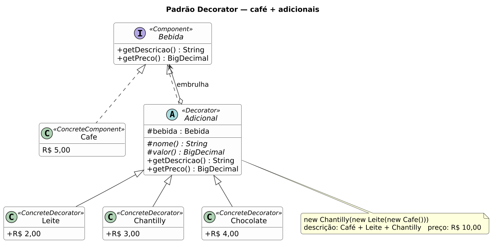
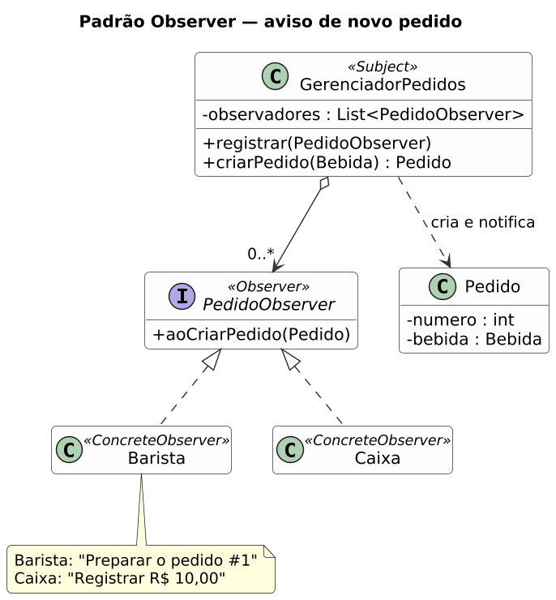

# Padrões de Projeto aplicados na Cafeteria

Sistema simples: o cliente monta um café com adicionais, o pedido é criado e o barista e o caixa são avisados.

## 1. Singleton — `GerenciadorPedidos`
**Categoria:** criacional.
**Propósito:** garantir que uma classe tenha **uma única instância** e oferecer um ponto global de acesso.
**Motivação:** se cada parte do programa criasse o seu próprio gerenciador, o número do pedido se repetiria e cada um veria uma lista diferente. Com Singleton existe **um só gerenciador**, que numera os pedidos e guarda a lista.
**Estrutura:** construtor `private`, atributo estático `instancia` e método estático `getInstance()`.

**Como explicar:** "Só existe um gerenciador de pedidos; todo mundo pede a ele com `getInstance()` e recebe sempre o mesmo objeto."

## 2. Decorator — `Bebida` e `Adicional`
**Categoria:** estrutural.
**Propósito:** acrescentar responsabilidades a um objeto **dinamicamente**, sem usar herança.
**Motivação:** o cliente combina café, leite, chantilly e chocolate como quiser. Com herança seriam classes como `CafeComLeite`, `CafeComLeiteEChantilly`, `CafeComLeiteChantillyEChocolate`... Com Decorator, cada adicional **embrulha** a bebida anterior e soma descrição e preço.
**Estrutura:** `Bebida` (interface) ← `Cafe` (componente) e `Adicional` (abstrata, guarda uma `Bebida`) ← `Leite`, `Chantilly`, `Chocolate`.
**Exemplo:** `new Chantilly(new Leite(new Cafe()))` → "Café + Leite + Chantilly" = R$ 10,00.

**Como explicar:** "É como empilhar camadas: cada adicional chama o de dentro e acrescenta o seu preço."

## 3. Observer — `PedidoObserver`
**Categoria:** comportamental.
**Propósito:** definir dependência **um-para-muitos**: quando o sujeito muda, todos os interessados são avisados.
**Motivação:** quando um pedido é criado, o barista precisa preparar e o caixa precisa registrar. Se o gerenciador chamasse os dois diretamente, ficaria preso a eles. Com Observer ele só avisa uma lista de `PedidoObserver`; novos interessados (cozinha, entregador) entram **sem mexer no gerenciador**.
**Estrutura:** `GerenciadorPedidos` (Subject, com `registrar` e notificação), interface `PedidoObserver`, observadores `Barista` e `Caixa`.

**Como explicar:** "É como assinar um canal: o gerenciador publica o pedido e quem assinou recebe."

## Como os 3 trabalham juntos
1. O **Decorator** monta o café com os adicionais e calcula o preço.
2. O **Singleton** (`GerenciadorPedidos`) cria o pedido com o próximo número.
3. O **Observer** avisa o barista e o caixa.
